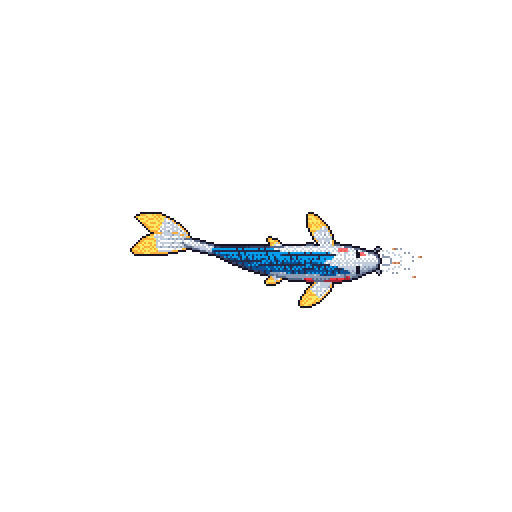

CS student at Queen's University Belfast, doing machine learning research.

<!--I study the gap between how models are **measured** and how they actually **behave**: what happens when a model is moved outside the conditions it was trained or evaluated under.-->

[ORCID](https://orcid.org/0009-0000-0016-6121) · [LinkedIn](https://www.linkedin.com/in/karl-hanna-88919a396/) · [arXiv](https://arxiv.org/a/hanna_k_1)

**Currently:** looking for a 9 - 12 month ML research / research engineering placement starting June - September 2027.

---

## Research

### [Amadeus Counterpoint](https://github.com/cotenthusiast/amadeus-counterpoint): *What happens when models of people meet?*

If you model two people separately, each learned only from their interactions with *other* people, can you put the two models together and reproduce how they interact with **each other**?

Chess is the controlled testbed: eight elite players, with every direct game between a pair held out during training.

<!-- TODO: one sentence with the headline result, e.g. "Composed player models recover X of the held-out pair's behaviour, measured by Y." -->

- Trained a 77.8M-parameter transformer from scratch with player-specific behavioural representations
- Leave-one-opponent-out training and held-out dyadic evaluation, run on SLURM/HPC

**Python · PyTorch · SLURM/HPC** · Independent research · Under review (AAMAS 2027)
[Paper](https://arxiv.org/abs/2609.35835) · [Code](https://github.com/cotenthusiast/amadeus-counterpoint)

<!-- TODO: one figure (e.g. the held-out dyad setup) -->

---

### [ChoiceBench](https://github.com/cotenthusiast/choicebench): *A model can be accurate without being consistent*

LLM multiple-choice scores mix up knowledge with sensitivity to the order the options appear in. Hiding option labels while the model commits to an answer, or scoring each option in isolation (unbiased by construction), does **not** reliably improve accuracy, while cyclic permutation often does. Removing positional influence and gaining accuracy turn out to be different things.

- Built the evaluation framework behind the paper: multiple answering strategies, benchmarks, hosted and local models, reproducible HPC runs
- Reproduced Zheng et al. (ICLR 2024) PriDe results at full MMLU scale (13,564 questions)
- Six models across MMLU and ARC-Challenge, with exact and bootstrap confidence intervals and per-question flip rates

**Python · PyTorch · Hugging Face · vLLM · SLURM/HPC** · Under Review (ARR, aimed at NAACL 27)
[Paper](https://arxiv.org/abs/2608.11947) · [Code](https://github.com/cotenthusiast/choicebench)

---

## Papers

- **K. Hanna**, C. Feng. *A, B, C, or Stable? Accuracy and Order Sensitivity Diverge in LLM Multiple-Choice Evaluation.* arXiv:2608.11947, 2026. [[paper]](https://arxiv.org/abs/2608.11947) [[code]](https://github.com/cotenthusiast/choicebench)
- **K. Hanna.** *Amadeus: When Models of People Meet.* arXiv:2609.35835, 2026. Under review. [[paper]](https://arxiv.org/abs/2609.35835) [[code]](https://github.com/cotenthusiast/amadeus-counterpoint)

---

## In progress: the Co stack

A planned ML stack built from first principles, from tensor operations up to a coding agent. Work in progress: CoTorch is underway, and the other two follow.

- **[CoTorch](https://github.com/cotenthusiast/CoTorch)** · *in progress*: a PyTorch-style framework with a C++ core. The plan covers tensors, autograd, neural networks and classical ML, on my own CPU kernels and a hand-written CUDA backend.
- **[CoInfer](https://github.com/cotenthusiast/CoInfer)** · *planned*: an LLM inference engine (autoregressive decoding, KV caching, batching and scheduling), to be built in parallel with CoTorch's CUDA backend.
- **[CoHarness](https://github.com/cotenthusiast/CoHarness)** · *planned*: a coding-agent harness covering model integration, tool calling, context management and agent loops.

Earlier from-scratch work: [mini-gpt](https://github.com/cotenthusiast/mini-gpt) · [BPE tokenizer](https://github.com/cotenthusiast/BPE-tokenizer) · [NumPy neural network](https://github.com/cotenthusiast/neural-network-from-scratch)

---

- **Languages:** Python · C++ · Java · Bash
- **ML & research:** PyTorch · NumPy · Hugging Face · vLLM
- **Infrastructure:** Linux · SLURM/HPC · Git · CI (GitHub Actions) · LaTeX
